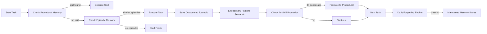

# Memory Orchestration

## When to Use
- When wiring the five layers together for the first time.
- When auditing whether all five layers are actually operational.
- When following the seven-day build path end to end.

## Purpose
Orchestrates all five memory layers working together as described in the 5-Layer Playbook. Complete pipeline from Day 1 through Day 7 build path.

## Vault Structure
- `00-Inbox/memory-pipeline.md` - Full pipeline status
- `00-Inbox/day-progress.md` - Day-by-day build progress
- `01-Projects/{{project-name}}/memory/` - Project-specific memory config
- `02-Areas/{{area}}/memory/` - Area-level memory configuration

## Seven-Day Build Path
| Day | Build | Exit Test |
|-----|-------|-----------|
| 1 | Add episodic log: save task outcomes to JSON | Agent recalls yesterday's failure |
| 2 | Add retrieval: query log before starting task | Agent skips known dead ends |
| 3 | Add semantic store: extract durable facts | Agent knows user preferences |
| 4 | Add ontology: define entity/relation types | Store validates against schema |
| 5 | Add procedural skills from repeated successes | Agent uses saved method |
| 6 | Add forgetting: expire old episodes, supersede facts | No contradictions in store |
| 7 | Wire the full pipeline: context → episodic → semantic → skills → forgetting | Full pipeline runs end-to-end |

## Data Flow


## Pipeline Loop


## Memory Configuration Template
```yaml
MEMORY_CONFIG:
  episodic:
    store: ./memory/episodes.jsonl
    ttl_days: 90
    retrieve_top_k: 5
    supersede_on_conflict: true
    flag_contradictions: true
  semantic:
    store: ./memory/facts.db
    ontology: ./memory/schema.yaml
    conflict_policy: keep_newer
    audit_stale_days: 90
  procedural:
    store: ./memory/skills.yaml
    promotion_threshold: 3
    version_history: 5
  forgetting:
    schedule: daily
    expire_episodes: 30d
    supersede_on_conflict: true
    flag_contradictions: true
```

## System Prompt Template
```markdown
You have access to a persistent memory system. Before starting any task:
1. Query episodic memory for similar past tasks
2. Load relevant semantic facts into context
3. Check if a procedural skill exists for this task type

After completing any task:
1. Save the outcome to episodic memory
2. Extract any new durable facts to semantic memory
3. If this approach worked 3+ times, propose it as a skill

Never assume you remember something from a previous session. Memory is the source of truth, not your training.
```

## Operations
### `run_pipeline` - Execute full memory pipeline for a task
### `day_progress` - Track day-by-day build progress
### `check_pipeline_status` - Verify all 5 layers are operational
### `weekly_audit` - Compare facts against current reality, flag stale items
---
